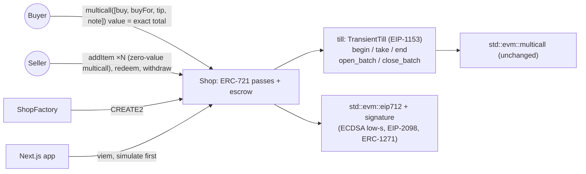

# Till — every wei counted once

**Pitch:** Till makes payable batching safe in Fe: every wei sent to a batched
transaction is counted exactly once, a rule enforced by Fe's effect system and
EIP-1153 transient storage, and it ships with a one-tap ticket-and-merch
checkout app that depends on it.

| | |
|---|---|
| Fe version | `fe 26.6.0 (5b3f96a)` (`FE_VERSION: v26.6.0` in CI) |
| Manifest | [`fe.toml`](fe.toml) (workspace) → `ingots/{till,shop,naive,actors}/fe.toml` |
| Try it | `make setup && make test && make demo` → http://localhost:3000 |
| Evidence | [`docs/TEST_REPORT.md`](docs/TEST_REPORT.md): 249 Fe tests (960 random batches), 6 negative compile tests, 48 E2E on real bytecode, 19 Playwright tests |
| License | Apache-2.0 |

## The problem

Fe's standard library batches calls with `std::evm::multicall`, and the
example in its own doc comment makes the batch handler payable
(`ingots/std/src/evm/multicall.fe` at `v26.6.0`):

```fe
recv MulticallMsg {
    #[payable]
    Multicall { data } -> Vec<Bytes> uses (ctx, mut call) {
        multicall::multicall(data)
    }
}
```

The same file then warns:

> Every entry is `DELEGATECALL`ed to the contract itself, so it runs with
> the original caller and value … a `#[payable]` handler could count one
> payment several times.

and Fe's own test `value_reaches_every_entry`
(`crates/fe/tests/fixtures/fe_test/multicall.fe`) asserts that every entry
sees the full `msg.value`. So a shop whose payable `Buy` checks
`ctx.value() == price` passes that check once per entry. In our regression
test (`ingots/shop/src/tests/exploit.fe`, also live on `/lab`), honest buyers
pay 9 ETH; Mallory pays 1 ETH once, batches five 1 ETH buys, gets 14 passes
minted for 10 ETH paid, refunds her five, and leaves with **4 ETH of other
buyers' money**. The shop can no longer refund everyone. This is the bug class
samczsun disclosed in SushiSwap's MISO auction in August 2021, `msg.value`
reused inside a delegatecall batch
([samczsun, "Two Rights Might Make A Wrong"](https://samczsun.com/two-rights-might-make-a-wrong/);
see also [Trail of Bits on the MISO and Opyn `msg.value` reuse](https://blog.trailofbits.com/2021/12/16/detecting-miso-and-opyns-msg-value-reuse-vulnerability-with-slither/)).

Three adjacent problems come with it:

1. **Stuck ETH.** A non-payable handler reverts when delegatecalled in a paid
   batch, so developers mark *everything* payable, and stray ETH sent to a
   handler that never expected value gets stuck.
2. **Cross-frame leaks.** EIP-1153 transient storage survives across calls in
   one transaction (the next ERC-4337 UserOperation, a router's second call).
   A "transient budget" that isn't zeroed at every frame boundary is a new bug.
3. **Foreign code mid-batch.** If a batched handler sends ETH or calls a token
   receiver, attacker code runs while the budget is live and can re-enter.

**Would this exist without this chain or product?** No. It needs EVM
`DELEGATECALL` (which preserves `msg.value`), EIP-1153 transient storage, and
Fe's std multicall shipped with a payable example. Remove any one and the
problem disappears.

## Approach

`till` is a Fe library. A contract adds one transient field and brackets each
payable handler:

```fe
#[payable]
Buy { item, qty } -> u256 uses (ctx, mut register, mut catalog, mut passes, mut books, mut log) {
    register.begin(ctx.value(), from: ctx.caller())   // the only place msg.value is read
    let first = with (Till = register) { purchase(item, qty, to: ctx.caller(), buyer: ctx.caller()) }
    register.end()                                     // direct call: budget must be exactly 0
    first
}
```

and swaps `multicall(data)` for `metered_multicall(data)`, which opens one
budget of `msg.value` for the whole batch, runs std's multicall unchanged, and
requires the budget to be spent exactly. Inside a batch, `begin` ignores the
value every entry sees and only checks the frame comes from the payer.

| Invariant | How |
|---|---|
| **I1** Σ drawn == `msg.value`, exactly | `take` reverts `Overspend{wanted,left}`; `end`/`close_batch` revert `Unspent{left}` |
| **I2** no stuck ETH | metered handlers reject leftovers; everything else is non-payable |
| **I3** no cross-frame leak | every success path zeroes all five `TSlot`s |
| **I4** no foreign code mid-batch | business logic has no `Call` effect (**compiler-checked**); payout handlers call `forbid_in_batch`; re-entrant frames from non-payers get `ForeignFrame` |
| **I5** no nested batches | `NestedBatch` |
| I6–I12 | shop accounting, escrow, EIP-712 check-in, anti-rug rules, payout safety, limits, ownership ([details](docs/THREAT_MODEL.md)) |

On top of it, `shop` is a real product: `ShopFactory` opens one `Shop` per
seller (CREATE2, address shown before confirming); each `Shop` is the ERC-721
collection of its passes, holds each pass's price in per-item escrow, releases
it to the seller only when the **holder** signs an EIP-712 `CheckIn` at the
door (or after `release_at`), and refunds 100% of what each pass paid if the
seller cancels. The Next.js app gives buyers a silent burner wallet, a
one-tap faucet and **one tap, one transaction, one exact payment** for a whole
cart.

Everything in this repository was built during the contest (see Declaration).

## Fe highlight: the compiler proves the money rules

```fe
// ingots/shop/src/sales.fe
pub fn purchase(item: u256, qty: u256, to: Address, buyer: Address) -> u256
uses (register: mut Till, catalog: mut Catalog, passes: mut Passes, books: mut Books, log: mut Log)
```

`purchase` has the `Till` trait effect and no `Ctx` and no `Call`. It
cannot read `msg.value`, so the only way it can get paid is
`register.take(...)`, which draws from the one budget: no double counting (I1).
It cannot run foreign code, so nothing can re-enter while a batch budget is
live (I4). This is a type error rather than a review finding: calling any
function that needs `Ctx` or `Call` from here fails with
`error[8-0036]: missing effect`, and `tests/compile_fail/` checks exactly that
in CI. The same `Till` effect is implemented three ways: `TransientTill`
(production), `LedgerTill` (pure unit tests, no EVM) and `Payment` (a linear
value whose `Drop` reverts on unspent wei). That is the `Rng`/`ReplayRng`
pattern from `std::evm::random`, applied to money.

## Architecture



- `ingots/till`: the library (`effect.fe`, `transient.fe`, `ledger.fe`,
  `payment.fe`, `metered.fe`, `errors.fe`) and its tests.
- `ingots/shop`: `Shop`, `ShopFactory`, effect-typed logic (`sales.fe`,
  `passes.fe`), pure rules (`rules.fe`), EIP-712 (`checkin.fe`), tests.
- `ingots/naive`: `NaiveShop`, vulnerable on purpose, for the regression test
  and `/lab`.
- `ingots/actors`: test-only users, attackers, relays and receivers (`fe test`
  has no pranks, so every distinct sender is a contract).
- `app/`, `e2e/`, `scripts/`: TypeScript front end, E2E and tooling.

More: [docs/ARCHITECTURE.md](docs/ARCHITECTURE.md) (state machine, sequence
diagram, message table, storage, deviations from the plan),
[docs/THREAT_MODEL.md](docs/THREAT_MODEL.md),
[docs/STDLIB_PROPOSAL.md](docs/STDLIB_PROPOSAL.md),
[docs/EXPLAIN_LIKE_A_JUDGE.md](docs/EXPLAIN_LIKE_A_JUDGE.md),
[docs/COMPILER_ISSUES.md](docs/COMPILER_ISSUES.md).

## Build and test

```bash
fe --version   # fe 26.6.0 (5b3f96a)
```

```bash
make setup     # Fe 26.6.0 (feup), Foundry (anvil), node deps
```

```bash
make test      # fe fmt --check, fe test (all ingots), compile_fail, lint
```

```bash
make e2e       # fe build + anvil --hardfork osaka + vitest on real bytecode
```

```bash
make demo      # anvil + deploy + seed + next dev → http://localhost:3000
```

Plain Fe, without make: `fe test` and `fe build` at the repository root. Other
tools: Foundry's `anvil` (Osaka hardfork) for E2E and the demo, Node 22 for
the app and scripts, Playwright (`make playwright`) for UI tests.
`make report` regenerates [docs/TEST_REPORT.md](docs/TEST_REPORT.md).

| Layer | Count |
|---|---|
| Fe pure unit tests (LedgerTill, Payment, rules, EIP-712 vectors) | 43 |
| Fe EVM integration tests | 194 |
| Fe seeded property tests (6 + 6 seeds, 960 random batches with 7 mutation kinds) | 12 |
| Negative compile tests (effect violations must not compile) | 6 |
| E2E on anvil, real bytecode, distinct EOAs | 48 |
| Playwright (desktop + Pixel 7) | 17 |

Every invariant and threat row maps to named tests in
[`scripts/test-map.ts`](scripts/test-map.ts); the report checks they exist
and passed.

## Demo

- **Local, one command:** `make demo`. It starts anvil, deploys the factory, a
  seeded "Uyo Dev Meetup" shop and the `/lab` pair (NaiveShop and a Till shop,
  9 honest purchases each), records example transactions, and runs the app.
  Visit `/` to sell, `/s/<shop>` to buy, `/passes`, `/s/<shop>/door`, `/lab`.
- **CLI exploit:** `npx tsx scripts/demo-exploit.ts --target naive` drains
  NaiveShop; `--target till` reverts with `Overspend(1000000000000000, 0)`.
- **Videos:** pitch (≤ 3:00) and technical walkthrough, scripted in
  [docs/VIDEO_SCRIPTS.md](docs/VIDEO_SCRIPTS.md). _Links: to be added after recording._
- **Live app:** https://app-eight-gamma-97.vercel.app (Sepolia).
- **Sepolia** (deployed with `make deploy-sepolia`; on-chain code verified
  against a fresh build with `scripts/verify-bytecode.ts`):

  | | Address / transaction |
  |---|---|
  | ShopFactory | [`0xa4feba51e2d02816dd3b5d057692edc08696ceb9`](https://sepolia.etherscan.io/address/0xa4feba51e2d02816dd3b5d057692edc08696ceb9) |
  | Demo shop "Uyo Dev Meetup" | [`0x7878b2E1F9842a8a45d8f1614D4e2eCE3fBbb0C7`](https://sepolia.etherscan.io/address/0x7878b2E1F9842a8a45d8f1614D4e2eCE3fBbb0C7) |
  | Lab: NaiveShop | [`0xcb85bde6ef9978a7378017abd6cb92046b359c16`](https://sepolia.etherscan.io/address/0xcb85bde6ef9978a7378017abd6cb92046b359c16) |
  | Lab: Till shop | [`0x8deb2466d920461c9129406d45b8FacEa8A2f600`](https://sepolia.etherscan.io/address/0x8deb2466d920461c9129406d45b8FacEa8A2f600) |
  | Batched checkout (2 tickets + shirt + tip, one tx) | [`0xb3282737…`](https://sepolia.etherscan.io/tx/0xb3282737fc9224e292a4a90695f9a57d00d5fa5236523de130cc77ab566cfcfc) |
  | Redeem (EIP-712 check-in) | [`0x17017ef3…`](https://sepolia.etherscan.io/tx/0x17017ef3a1b6909086b66922bc2258cbfd3472fc6b98171cdabbde72c0bbb28b) |
  | Refund after cancel | [`0x292c1bbd…`](https://sepolia.etherscan.io/tx/0x292c1bbd7330c017d79e13ae55a66933d3fb03b5ce060a3bd23e3b699b54e2d8) |
  | Withdraw | [`0x99770ae2…`](https://sepolia.etherscan.io/tx/0x99770ae21783169e74726fd77195c8f9e6cc5e5cedf01d000ca2b0209ebda6a1) |

  Full record: [`deployments/sepolia.json`](deployments/sepolia.json).

Gas (anvil): Till adds about **1.2k gas per batched entry** plus ~1.4k per
batch over identical logic without it; `redeem` with EIP-712 + ecrecover costs
about 76k gas. Contract sizes: `Shop` 11.3 KB, `ShopFactory` 12.3 KB runtime
(EIP-170 limit 24 KB).

## Limitations

- Fe is pre-production and this code is unaudited. Testnet only.
- Burner keys live in `localStorage`; fine for test ETH only. "Copy/Download
  key" is the backup.
- Per-wallet caps are Sybil-weak (one person, many wallets).
- `release_at` and signature deadlines trust block timestamps.
- Escrow protects buyers only until `release_at`. After that the seller can
  release funds and still not hold the event.
- `core::mem::forget` bypasses `Payment`'s Drop guard (CI bans `forget(` in
  `till` and `shop`; the shop uses `TransientTill`).
- Till protects only handlers that use it. Inside the shop, a lint pins the
  payable handler set and `ctx.value()` usage; elsewhere it is up to adopters.
- No ERC-4337 smart account or paymaster in the MVP; cross-frame safety is
  tested with a `Relay` contract and multi-call transactions instead.
- Etherscan can't verify Fe source; `scripts/verify-bytecode.ts` compares the
  on-chain code with a fresh build instead (runtime ++ immutables).
- Test-only contracts are emitted by `fe build` too (Fe has no `cfg(test)`).
- The ₦ amounts are a fixed-rate estimate, not a price feed.

## Declaration

- **Pre-existing work:** the starting point is
  [fe-lang/builders-challenge-starter](https://github.com/fe-lang/builders-challenge-starter)
  at `f9d9aa92a03af82c2bbb0dc2e0810244eb13e686` (license, CI skeleton,
  `SUBMISSION.md`). Before the build the author wrote a spike (the build
  prompt's Appendix A/B: a 9-test NaiveBank/TillBank exploit and fix, plus a
  trait-effect/factory probe), written on Nov 17, 2026, during the contest
  window. Everything else in this repository was written during the contest.
- **Third-party code:** Fe's std library (`multicall`, `eip712`, `signature`,
  `mutex`, `erc721::check_on_received`, `random::KeccakRng`, `StorageMap`,
  `TSlot`), used as a dependency and not copied. ERC-721 and ERC-165 semantics
  follow the EIPs and OpenZeppelin's behavior (no code copied). The TypeScript
  side uses viem, Next.js, React, Tailwind, zod, qrcode, jsQR, vitest and
  Playwright under their own licenses. Anvil's public test keys are used for
  local demos and test vectors.
- **AI assistance:** Claude Code wrote most of the code, tests and docs under
  Greg's direction, from his build prompt and spike. Greg reviewed, tested
  and can explain every part.

## Team

Greg ([emediong-etuk](https://github.com/emediong-etuk)).

## License

Apache-2.0 (see [LICENSE](LICENSE)), kept from the starter.
