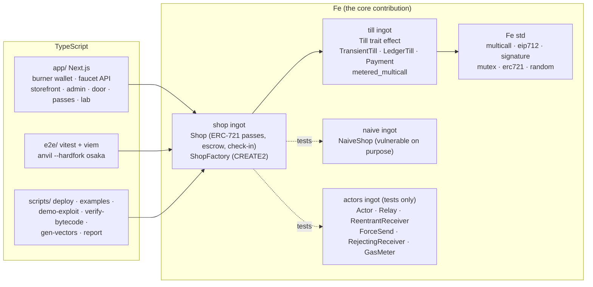
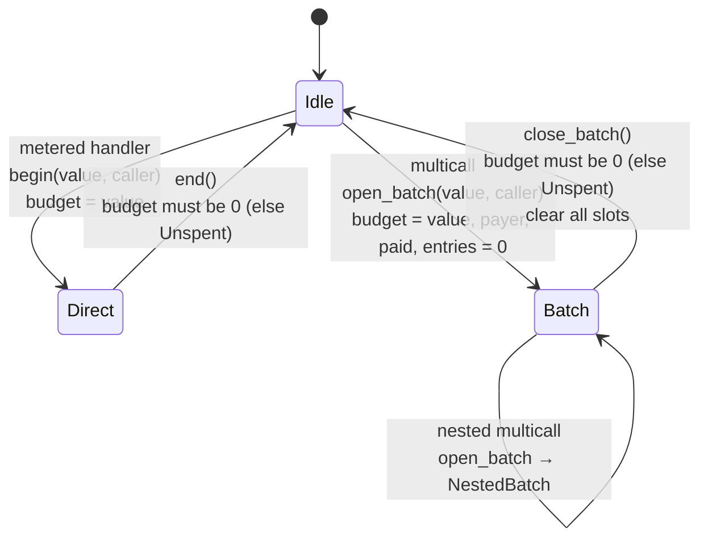
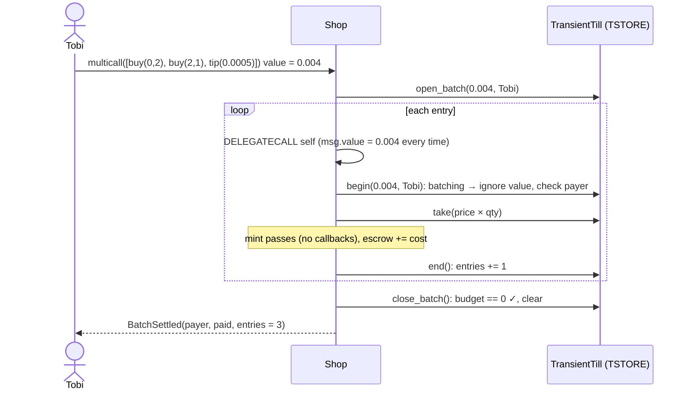

# Architecture

Fe version: `fe 26.6.0 (5b3f96a)`. Workspace: `fe.toml` with four member
ingots; `shop` depends on `till` (the library), `actors` and `naive` (both
only for tests and the lab).

## Ingots and modules

| Ingot | Module | Contents |
|---|---|---|
| `till` | `effect.fe` | `trait Till { take, left, in_batch }`, `charge(price, qty) uses (mut Till)` |
| | `transient.fe` | `TransientTill` (five `TSlot`s), `TillState`, `BatchReceipt` |
| | `ledger.fe` | `LedgerTill` for pure unit tests |
| | `payment.fe` | `Payment`, a linear `Till` whose `Drop` reverts `Unspent` |
| | `metered.fe` | `metered_multicall(data)` = `open_batch` → `std::evm::multicall::multicall` → `close_batch` |
| | `errors.fe` | `Overspend`, `Unspent`, `NestedBatch`, `ExternalCallInBatch`, `ForeignFrame` |
| | `calldata.fe` | `entry(msg)`: one multicall entry from a typed message |
| | `probe.fe` | `TillProbe`, the smallest correct adopter (used by the library's tests) |
| `shop` | `shop.fe` | `Shop` contract: handlers only; logic lives in the modules below |
| | `sales.fe` | `purchase`, `tip`, `note`: **no `Ctx`, no `Call`** |
| | `passes.fe` | ERC-721 bookkeeping (approve, transfer, burn): no `Call` |
| | `rules.fe` | pure item rules: `check_purchase`, `check_update`, `check_release`, `can_refund`, … |
| | `checkin.fe` | EIP-712 `CheckIn` typehash, struct hash, digest |
| | `state.fe` | storage structs: `Catalog`, `Passes`, `Books`, `Ownership`; ABI views |
| | `factory.fe` | `ShopFactory`: `open`, `predict`, `shopAt`, `count` |
| | `uri.fe` | `name`/`symbol` from `bytes32`, `tokenURI = base ++ 0x<shop> ++ / ++ id` |
| | `vectors.fe` | generated EIP-712 vectors (viem) |
| | `testkit.fe` | helpers shared by the test files |

## The Till state machine

All state is EIP-1153 transient storage, so it starts at zero in every
transaction, and every successful path ends with every slot at zero (I3).
A revert also reverts the transient writes.

## A batched checkout

## Messages

All selectors are Solidity-compatible (`#[selector = sol("…")]`), so viem uses
`out/Shop.abi.json` directly. The compiler infers `view`/`pure`.

| Handler | Payable | Metered | Effects (beyond reads) | Batched? |
|---|---|---|---|---|
| `buy`, `buyFor`, `tip`, `note` | yes | yes | `mut register`, catalog/passes/books, `mut log` — **no `call`** | paid batches |
| `multicall` | yes | opens the batch | `mut call` (std multicall), `mut register` | — (nesting reverts) |
| `addItem`, `updateItem`, `pause`, `resume`, `cancel`, `extendRelease`, `release` | no | — | owner check | zero-value batches |
| `redeem` | no | — | `call` (read-only: ERC-1271 `STATICCALL`) | zero-value batches (door queue) |
| `withdraw`, `sweep`, `refund`, `safeTransferFrom` ×2 | no | — | `mut call`, `forbid_in_batch`, payout `Mutex` | refused in batches |
| `transferFrom`, `approve`, `setApprovalForAll` | no | — | no `call` | zero-value batches |
| views | no | — | — | zero-value batches |

`scripts/lint.sh` (CI) checks that the payable set is exactly
`Buy BuyFor Multicall Note Tip`, that `ctx.value()` appears in the shop only
as `register.begin(ctx.value(), …)`, and that `forget(` never appears.

## Storage

| Field | Type | Notes |
|---|---|---|
| `ownership` | `Ownership { owner, pending }` | two-step transfer |
| `name`, `symbol`, `uri0`, `uri1`, `uri_len` | `u256` immutables | appended to runtime code |
| `catalog` | `Catalog { items: Map<u256, Item>, count, bought: Map<(u256, Address), u256> }` | `Item` holds price, supply, sold, cap, release_at, escrow, status, kind, label |
| `passes` | `Passes { passes: Map<u256, Pass>, balance_of, approved, operator: Map<(Address, Address), bool>, minted }` | `Pass { owner, redeemed, item, paid }`, ids from 1 |
| `books` | `Books { total_escrow, seller_available, tips_total }` | I6 |
| `register` | `TransientTill` | transient |
| `payout` | `Mutex<bool>` | transient lock bit |

## Decisions and deviations from the build prompt

| Prompt | What we did | Why |
|---|---|---|
| `begin(_ paid: Wei)` | `begin(_ paid: Wei, from: Address)` and a `ForeignFrame` error | Defense in depth for I4: if any handler ever lets foreign code run mid-batch, a re-entrant frame from a non-payer cannot spend the batch budget (`foreign_frame_mid_batch_is_rejected`). |
| field `mut till: TransientTill` | field `mut register: TransientTill` | Compiler issue 1 (name collision with the `till` ingot). |
| `TransientTill` with four `TSlot`s | five (`paid` added) | The shop emits `BatchSettled{paid}` without reading `ctx.value()` outside `begin` (lint rule). |
| optional `Payment` | `Payment` implements the `Till` trait | The same business logic (`charge`) runs over `TransientTill`, `LedgerTill` and `Payment`. |
| `Redeem` forbids batches? | allowed in zero-value batches | Its only foreign code is an ERC-1271 `STATICCALL`, which cannot write storage or transient storage (EIP-214). A door can admit a queue in one transaction. Paid batches still reject it (non-payable). |
| `Release` | owner-only | I12. |
| `Sweep{to}` | sends `selfbalance − total_escrow − seller_available` | Forced ETH is never mixed into the buckets. |
| `Refund{pass}` | pays the pass's current holder, callable by holder/approved/operator | An approved operator can trigger the refund but never receives it. |
| names | `bytes32` labels (≤ 31 UTF-8 bytes) | `FixedBytes<32>` encodes cleanly in messages and events; `name()`/`symbol()` return `string`. |
| `tokenURI` | composed on-chain: `<base><0x shop>/<id>` | base (≤ 64 bytes) is a factory immutable; the app serves JSON + SVG. |
| ForceSend via selfdestruct | hand-built init code | Compiler issue 2. |
| single vs multi-ingot | multi-ingot workspace worked | No fallback needed. |
| Sepolia deployment | scripts ready, not run from the build sandbox | The sandbox's network policy blocks every Sepolia RPC and it holds no funded key. `make deploy-sepolia` does it in one command. |

## Phase 0 probe results

| Probe | Result |
|---|---|
| Appendix A (exploit + fix, 9 tests) and B (trait effect, mock, factory, ABI errors) | pass unchanged on 26.6.0 |
| Workspace + path dependencies, contracts across ingots, `create2<C>` of a dependency's contract | works |
| `Bytes32` in messages/events, `#[abi]` structs as returns (incl. `u8`, `bool`, `Timestamp`) | works |
| `StorageMap` with tuple keys and struct values, field-level updates | works |
| EIP-712 `domain_separator`/`digest` + `signature::recover` round trip vs viem | matches (vectors) |
| `Mutex<bool>` transient lock, `try_lock` | works |
| `send_value` to EOA (gas 0) and contract (needs forwarded gas) | works; payouts forward gas behind the lock |
| events in ABI JSON, custom errors from a dependency ingot in the ABI | works |
| `fe build` sizes | Shop 11.3 KB runtime, ShopFactory 12.3 KB (embeds Shop init code) |
| anvil `--hardfork osaka` deploy + call | works; eth_getCode = runtime ++ immutables |
| Sepolia deploy + call | **not run from the sandbox** (see above) |
